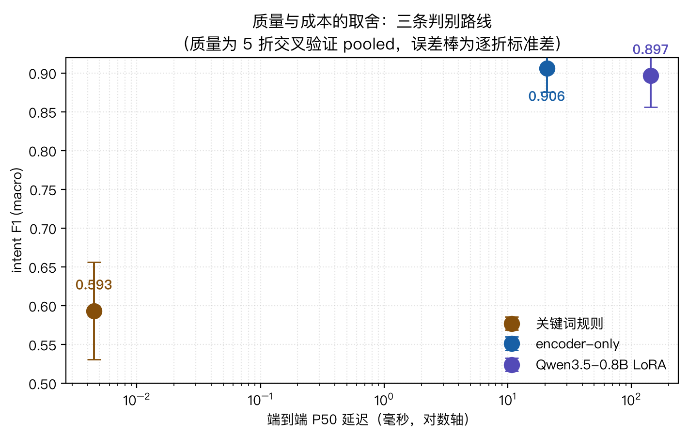

# 26 - 垂直领域判别模型 总览：从判别外置到自建内核

> **学习目标**：明确你要造的不是“某个 API 适配器”，而是一套可训练、可评估、可部署的垂直领域判别系统。

---

## 26.1 为什么要自建垂直领域判别模型

25 章已经给出结论：判别能力可以外置，但策略能力仍要自己训。  
当你进入生产场景，还会遇到三件硬约束：

1. 外部 API 可用性与成本不可控
2. 数据出域合规压力
3. 通用模型在垂类边界样本上精度不足

所以这条实现线的目标不是“如何调用 Jev/KEV/Laya”，而是：

> **如何一步一步手工造出你的垂直领域判别模型。**

---

## 26.2 垂直领域判别模型的系统边界

垂直领域判别模型 只做“判别层”，不做长文本生成。  
它输出的是结构化决策：

- `choice`：闭集分类（路由、等级、策略分支）
- `score`：有序评分（风险、复杂度、优先级）
- `bool`：是/否决策（是否升级、是否阻断）

换句话说，它解决的是：

```text
输入 state -> 输出可执行决策 + 置信度
```

而不是：

```text
输入 prompt -> 输出长文本回复
```

---

## 26.3 这条实现线的 8 个阶段（26–33）

| 阶段 | 章节 | 目标 | 本章交付物 |
|---|---|---|---|
| A | 26 | 定义系统边界与验收标准 | `xxev-spec.md`（你可按模板写） |
| B | 27 | 从业务流程提炼 schema | `schema/v0.json` |
| C | 28 | 建立数据标准与标注协议 | `labeling-guideline.md` |
| D | 29 | 做无模型基线（规则） | `baseline-rule-report.md` |
| E | 30 | 实现模型骨架（encoder + decision head） | `model.py` |
| F | 31 | 训练、校准与阈值 | `train.md` + `calibration-report.md` |
| G | 32 | 推理优化与低延迟部署 | `inference-benchmark.md` |
| H | 33 | 灰度上线、回滚与治理 | `rollout-playbook.md` |

---

## 26.4 统一验收指标（先定再做）

如果不先定义指标，后面所有“优化”都会失焦。  
垂直领域判别模型 至少要固定四个一级指标：

| 指标 | 定义 | 目标示例 |
|---|---|---|
| Accuracy/F1 | 判别正确率 | 主任务 F1 >= 0.85 |
| Calibration | 置信度是否可信（ECE/Brier） | ECE <= 0.06（**CV pooled 口径**；逐折均值另算，见下） |
| Latency | 单请求推理延迟（P95） | P95 <= 80ms（本地） |
| Cost | 每千请求成本 | 相比全量 premium 降低 60%+ |

> 注意：仅准确率高但置信度不可信，不能用于自动化分流。
>
> ⚠️ **ECE 门槛必须写清口径**：本仓库的 `ECE <= 0.06` 是按 **CV pooled**（5 折预测合并后算一次）口径判定的，实测 `0.0570` 刚好过线；但**逐折均值是 `0.0721 ± 0.0264`，按单模型视角不达标**。同一个模型，换个统计口径结论就翻——所以写门槛时必须注明是 pooled 还是逐折均值。

---

## 26.5 架构蓝图（先骨架，后细节）

```text
            ┌──────────────────────┐
state ----> │   垂直领域判别模型 Decision Core │ ----> choice/score/bool + confidence
            └──────────────────────┘
                       │
                       v
             routing / gating / escalation
                       │
                       v
               cheap / mid / premium
```

实现顺序建议：

1. 先把数据与 schema 固定
2. 先跑规则基线拿到可比较下限
3. 再做模型训练与校准
4. 最后做推理优化和上线治理

---

## 对应工程锚点（minimal-decision-bench）

这章看完后，直接打开这两个文件：

- 总入口：[`minimal-decision-bench/README.md`](./minimal-decision-bench/README.md)
- 小白导览：[`minimal-decision-bench/LEARNER-GUIDE.md`](./minimal-decision-bench/LEARNER-GUIDE.md)

本章的完成标准不是“跑分”，而是你能说清三件事：

1. 这个工程只做判别层，不做长文本生成。
2. 输出契约固定为 `choice/score/bool + confidence`。
3. 演示实验和正式业务结论是两回事（见发布边界）。

### 实测结果（5 折交叉验证，每条模板都被评测一次）

| 指标 | 本章门槛 | encoder-only | Qwen3.5-0.8B LoRA | 关键词规则 |
|---|---|---|---|---|
| 主任务 F1 | >= 0.85 | **0.9058** ✅ | 0.8967 ✅ | 0.5933 ❌ |
| ECE（**CV pooled 口径**） | <= 0.06 | **0.0570** ✅（勉强） | 0.0746 ❌ | 0.2667 ❌ |
| ECE（**逐折均值**，单模型视角） | — | 0.0721 ± 0.0264 ❌ | 0.0787 ± 0.0460 ❌ | 0.2667 ❌ |
| 端到端 P50 延迟（**三模型串行求和**） | — | 20.67 ms | 142.51 ms | **0.0045 ms** |
| 部署体积（**单任务模型**） | — | 390.6 MB | 1728.1 MB | 0（无需模型） |
| 部署体积（**三任务合计**） | — | 1171.8 MB | 5184.3 MB | 0（无需模型） |

> **三处口径提醒**：
> 1. **ECE 门槛只对 CV pooled 口径成立**（`0.0570`）。逐折均值 `0.0721 ± 0.0264` 说明**单模型视角不达标**——上线的模型只有一套，没有「把 5 折预测合并」这回事，这条门槛要按部署形态重新定。
> 2. **延迟 `20.67 / 142.51 ms` 已经是 intent + escalation + complexity 三个模型串行求和**（压测脚本就是这么算的），所以它和「三任务合计体积」是同一口径；「单任务模型体积」只表示单个模型的磁盘占用——**bench 的三个任务模型是三个独立模型**，不是共享权重的一套多头。
> 3. 部署体积列是**含底座、不含 optimizer/checkpoint** 的口径。



这份表要读出三件事：

1. **门槛是能被达到的，但要付出代价。** encoder 的 F1 `0.9058` 过了 0.85，ECE `0.0570`（**CV pooled 口径**）只是勉强过 0.06——按逐折均值 `0.0721 ± 0.0264` 就不达标了；Qwen 两项都没过。而关键词规则的 F1 只有 `0.5933`——**门槛本身就在告诉你「不用模型是过不了的」**。
2. **模型确实比规则好，而且差距是硬的。** 五个质量指标上，两条模型相对规则的差距都落在 **5~9 倍标准差（总体标准差 ddof=0 口径）**——**唯一例外：Qwen 的 complexity MAE 只有 1.08 倍**（那一项模型相对规则几乎没有优势）。这是**描述性**比值，衡量的是「差距相对折间波动的量级」，**不是显著性检验**；换个非统计的说法就是**明显超出种子波动**。**这一条必须先立住**——否则「判别外置」最该省掉的不是模型选型，而是模型本身。
3. **两条模型路线在质量上分不出高下。** 5 个指标上，encoder 与 Qwen 的差异**没有一个**在依赖校正 + Holm 校正后达到显著性门槛。其中 **escalation Brier 的差异方向在 5/5 折上完全一致**（encoder 更优，幅度约 12%），朴素配对 t p=0.0025，但 5 折交叉验证的折间不独立，依赖校正后 p=0.0107，精确 Wilcoxon p=0.0625——**定性为「值得注意但未证实」，不宣称统计显著**。其余四项的描述性差距是 intent F1 `0.33` / intent ECE `0.18` / escalation F1 `0.05` / complexity MAE `1.89` 倍总体标准差（ddof=0），方向也没形成一致多数。**选 encoder 的理由是成本低 7 倍，不是质量更高。**

> 提醒：这个结论对**数据集难度**高度敏感。在早期版本里模板用词与类别一一对应，一个几十行的关键词规则就能拿 F1 `1.0000`，比两个模型都高——那时这个 bench 证明的是「不需要模型」。详见 [28 章 28.6 难度标定](./28-数据工程I-标注协议与难例覆盖.md)。

---

## 26.6 发布边界（先说清）

- 本实现线自带的 `minimal-decision-bench` 数据默认是教学合成集；
- 小样本训练命令主要用于验证“从数据到报告”的工程闭环；
- 这些数字不应直接作为真实业务效果宣传。

如果你要对外发布模型效果，请至少补齐：

1. 真实业务样本评测集（含难例分层）。
2. 固定评测协议与重复实验（种子、阈值、版本可追溯）。
3. 线上灰度数据回放后的一致口径报告。

---

## 26.7 本章小结

- 你要造的是“判别系统”，不是“聊天模型”
- 关键不是 API 接入，而是**数据、校准、阈值、治理**
- 从下一章开始进入第一步：把业务流程压缩成 schema

下一章：**[27 - 任务建模：把业务流程压成可训练 Schema](./27-任务建模-把业务流程压成可训练Schema.md)**。

### 本章哪些内容本工程未实现

本章是**总览与验收标准**，大部分条目是「你应该产出什么」的方法学，不是已交付的代码。逐条对照：

| 本章内容 | 本工程状态 |
|---|---|
| 26.4 的四个一级指标与目标值（F1 / ECE / P95 / 成本） | **门槛已实现**并有实测值；但 `ECE <= 0.06` 只在 **CV pooled** 口径成立，逐折均值不达标（见上表） |
| 26.5 的架构蓝图 | **已实现**（`routing.py` + 三方对比） |
| 「单任务模型体积 / 三任务合计体积」 | **已实测**；bench 的三个任务模型是**三个独立模型**，不是「一个 encoder 三种输出头」 |
| 「模型比规则好 5~9 倍标准差」 | **已实测**（总体标准差 ddof=0 口径；唯一例外：Qwen 的 complexity MAE 只有 1.08 倍），但这是**描述性比值**，不是显著性检验 |
| 「encoder 与 Qwen 质量分不出高下」 | **已实测**，结论是「依赖校正 + Holm 后无指标存活」，escalation Brier 方向 5/5 一致但**未证实** |
| 26.3 表格里的 `xxev-spec.md` 等交付物 | **本仓库未提供**，是给你自己写的模板 |
| 「相比全量 premium 降低 60%+ 成本」 | **未实测**——bench 没有 premium 分支的成本基线 |

> 一句话：**验收指标和实测数字是真的；「一个判别内核」的整体叙述是方法学，本仓库只实现了其中一条最窄的垂直路径（单 schema、单模板库、三任务分类/回归）。**

---

## 实践入口

这条 26–33 章对应的可运行工程闭环项目在：

- [`minimal-decision-bench/`](./minimal-decision-bench/)

建议边读边跑，按 `README` 的命令顺序执行完整链路。
